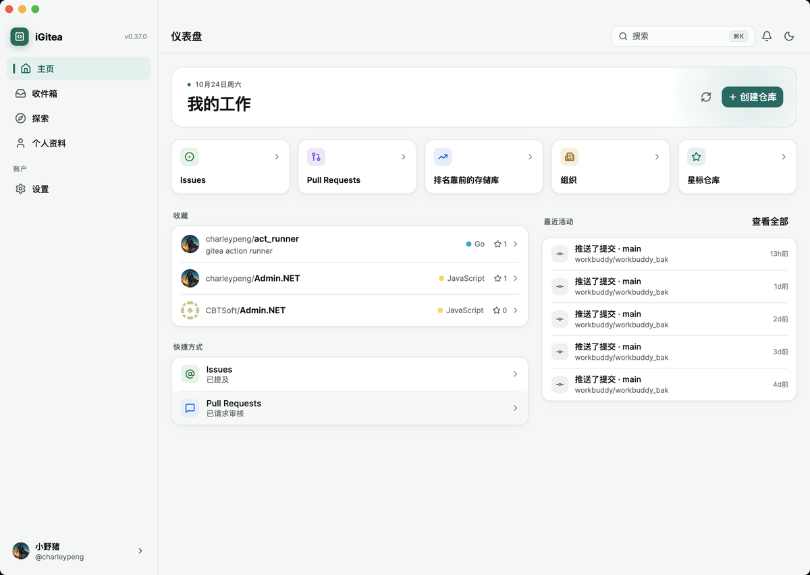
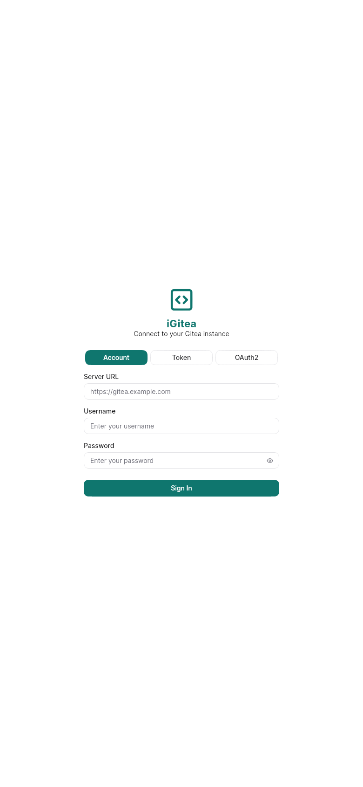
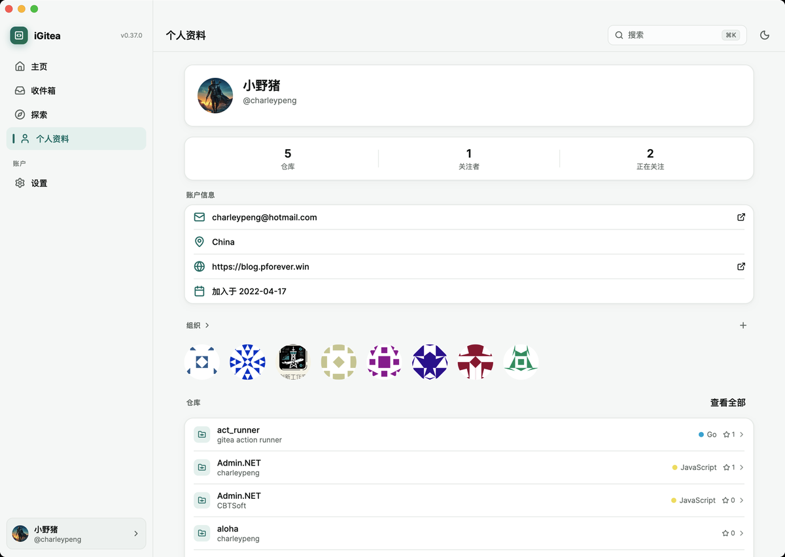
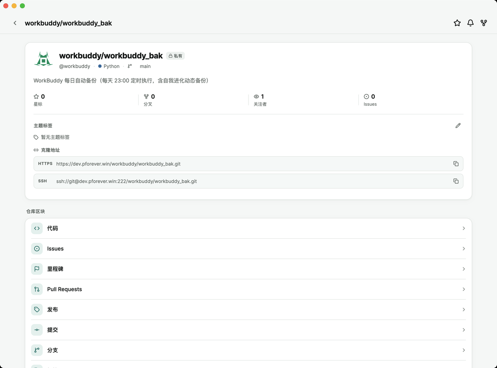

# iGitea

A cross-platform Flutter client for [Gitea](https://gitea.io), built from the OpenAPI specification.

> Built with OpenCode & Kimi 2.6 — PRs welcome! Help us if you have extra token, we are desperately waiting lol!

## Screenshots

| Home | Login | Profile | Repositories |
|:----:|:-----:|:-------:|:------------:|
|  |  |  |  |

## Features

### Core
- Cross-platform: Android, iOS, macOS, Linux, Windows, **Web**
- Clean Architecture + Repository Pattern
- **Forui** design system (shadcn-style) with a teal brand theme, light/dark palettes and adaptive navigation
- **Refreshed desktop-first UI**: hand-built sidebar shell, editorial dashboard, card-based repository overview, compact issue rows, skeleton loading and fade-through transitions
- **Desktop workspace**: three-pane repository overview, a list-detail issue workspace with a metadata rail, a collapsible icon-rail sidebar, right-click context menus and a keyboard shortcut sheet
- **Adaptive by window size, tuned by platform**: iPads and Android tablets in landscape get the same multi-pane workspaces as desktop; portrait tablets get a captioned navigation rail; phones get large titles, grouped lists and a slightly larger touch type scale with 40–44pt hit targets. Keyboard hints and hover-only affordances appear only on pointer platforms
- Token-driven palette, typography, spacing and motion with reduced-motion support
- 120+ data models auto-generated from OpenAPI spec
- 49+ domain use cases with `Either<Failure, T>` pattern
- 311 tests passing, `flutter analyze` clean (no errors)
- Home page redesign (GitHub Mobile style): implementation spec in `docs/igitea-home-redesign-spec.md`

### Authentication
- Username/password login (primary)
- Access token login (secondary)
- OAuth2 login: browser authorization → callback code → token exchange
- Session persistence and auto-restore

### Repositories
- List, search, and browse repositories
- **Advanced search filters**: sort (relevance, alphabetical, newest, recently updated, most stars, largest), order (ascending/descending), private only, archived, templates
- Collapsible header with star/watch/fork actions
- Section list navigation: Code, Issues, Milestones, Pull Requests, Releases, Commits, Branches, Tags, Wiki, Webhooks, Labels (tap to open)
- File browser with breadcrumb navigation
- File viewer with Markdown rendering, images, and syntax highlighting
- Edit files with commit message dialog
- Repository settings: edit description, visibility, features, or delete
- **Repository topics**: view and edit topics via dialog

### Issues & Pull Requests
- List, search, and **advanced filter** issues and PRs (labels, milestones, type, assignee, created by me, mentioned me)
- Touch-friendly filter BottomSheet with apply/reset actions, active filters shown as deletable chips
- Detail pages with Markdown body, state badges, author avatars, labels
- Comments with Markdown rendering
- Create issues: title, body, label selection, milestone selection
- Edit issues: title, body, state toggle, label selection, milestone selection, **due date**
- Close/reopen issues, merge PRs with confirmation
- **Issue dependencies**: add/remove dependencies with navigation to linked issues
- **Issue subscriptions**: subscribe/unsubscribe toggle with status indicator
- **Due date display**: visual overdue warning for past-due open issues
- **Saved Filters**: save and restore issue list filter presets via SharedPreferences

### Milestones
- List milestones with progress bars and open/closed counts
- Milestone detail with linked issues, edit and delete actions
- Create milestones: title, description, due date

### Wiki
- Wiki page list
- Wiki detail with Markdown rendering (selectable text)
- Create wiki pages: title, Markdown content, preview toggle, commit message
- Edit wiki pages: same as create, pre-filled with existing content
- Delete wiki pages with confirmation dialog

### Labels
- List labels with color indicators, name, and description
- Create labels: name, description, color picker (preset palette)
- Edit labels: same as create, with delete support

### Webhooks
- List webhooks with type, URL, and active status
- Webhook detail: configuration, events list, edit and delete actions
- Create webhooks: URL, secret, content type, event multi-select, active toggle
- **Edit webhooks**: full edit form with pre-filled existing values
- **Organization-level webhook management**: list, create, edit, and delete org webhooks

### Collaborators
- List repository collaborators
- Add/remove collaborators with user search

### Branch Protection
- List branch protections with branch name and creation date
- Create branch protection for a branch name
- Delete branch protection with confirmation

### Packages
- Browse packages with type filter chips
- Package detail: type, version, creator, created date, repository link
- File list with human-readable sizes
- Delete package version with confirmation

### CI/CD Actions
- Workflow runs grouped by workflow file
- Status filter (success/failure/in_progress etc.) + actor filter
- Infinite scroll pagination
- Job log auto-polling every 5s
- Run detail: jobs list, expandable logs, artifact download

### Organizations & Teams
- View organization info, repositories, and teams
- Click org avatars to navigate to detail page
- List organization repositories with navigation
- Team detail page with members and repositories
- Create/edit/delete teams with permission management
- **Delete organizations** with confirmation dialog
- Edit organization name, description, location, website, email, visibility
- Create new organizations from profile

### Releases
- Browse releases with assets download
- Release detail page with body, assets, tarball/zipball links

### Starred Repositories
- View all starred repositories from profile
- Star/unstar with toggle button
- Watch/unwatch with toggle button

### Activity Feed
- Dedicated activity feed page with infinite scroll, loading/error/empty states
- Activity rows show op-type icon + localized action text + repo + relative time; tap opens the repo
- Supports: create/delete repo, push/delete tag, create/close/reopen issues and PRs, comments, fork, transfer

### Home Page (GitHub Mobile style)
- Four-section dashboard: My Work shortcuts, Favorites (my repos, with loading/error/retry states), Shortcuts (mentioned / review requested), Recent (activity feed top 5 + View all)
- Bottom navigation: Home / Inbox / Explore / Profile

### Notifications
- List notifications with unread badge
- Mark single or all as read

### Search
- Global search for repositories and issues
- Real-time search results

### PR Diff Viewer
- Unified diff parsing with file-level navigation and @@ hunk headers
- Line-level added (green) / removed (red) highlighting with line numbers
- Unified / Split view toggle
- Code review: Comment / Approve / Request Changes

### File Operations
- File viewer: syntax highlighting, Markdown rendering, edit, download
- File history: commit timeline, tap to view commit details
- File compare: base/head ref input with diff rendering
- Blame view: per-line commit SHA and author annotation

### Commit Details
- Commit info, author, SHA copy, stats (+/-)
- Changed files with expandable inline diff (line-level coloring)

### Settings
- Theme: Light / Dark / System
- Language selection (10 supported)
- Account info display
- **Personal Access Tokens**: list, create, and delete tokens
- SSH Keys, GPG Keys, Emails management
- Admin Panel: user management, system hooks, cron tasks, action runners, email logs, user badges (admin only)
- User OAuth2 applications: list, create, and delete OAuth apps

### Internationalization
- English (en)
- Chinese Simplified (zh)
- Chinese Traditional (zh_TW)
- Japanese (ja)
- Korean (ko)
- Spanish (es)
- French (fr)
- German (de)
- Portuguese (pt)
- Russian (ru)

### Deep Links
- `/{owner}/{repo}` — repository
- `/{owner}/{repo}/issues/{id}` — issue
- `/{owner}/{repo}/pulls/{id}` — pull request

## Tech Stack

| Layer | Technology |
|-------|------------|
| Framework | Flutter |
| State | ChangeNotifier + ListenableBuilder |
| HTTP | http package |
| Storage | path_provider, shared_preferences |
| i18n | flutter_localizations |
| UI | Forui 0.21 + custom design tokens (semantic palette, motion, surfaces) |
| Links | url_launcher |
| File Picker | file_picker |
| Markdown | flutter_markdown |

## Getting Started

### Prerequisites

- Flutter SDK >= 3.11.5
- Dart SDK >= 3.11.5

### Build

```bash
# Install dependencies
flutter pub get

# Run (dev)
flutter run

# Build APK (Android)
flutter build apk --debug

# Build macOS
flutter build macos

# Build web
flutter build web
```

### Test

```bash
flutter analyze
flutter test
```

### App icons

All platform icons come from one generator. Edit the colours or glyph in `tool/icons/generate_icons.py`, then run:

```bash
python3 tool/icons/generate_icons.py
```

### UI review

Render key screens against a fake Gitea backend at phone, tablet (portrait and landscape) and desktop sizes. PNGs land in `tool/ui_review/out/`:

```bash
flutter test tool/ui_review --update-goldens
UI_REVIEW_DARK=1 UI_REVIEW_ONLY=home,repo UI_REVIEW_DEVICE=phone,tablet flutter test tool/ui_review --update-goldens
```

## Project Status

All phases complete.

| Phase | Description | Status |
|-------|-------------|--------|
| 1 | Project Bootstrap | ✅ Done |
| 2 | Model Generation | ✅ Done |
| 3 | API Service | ✅ Done |
| 4 | Repository Layer | ✅ Done |
| 5 | Domain Use Cases | ✅ Done |
| 6 | State Management | ✅ Done |
| 7 | UI Layer | ✅ Done |
| 8 | Testing & Quality | ✅ Done |
| 9 | Repo Detail & File Browser | ✅ Done |
| 10 | Issue/PR Detail & Search | ✅ Done |
| 11 | Settings & Admin | ✅ Done |
| 12 | Internationalization | ✅ Done |
| 13 | Wiki, Milestone CRUD, Webhooks, Labels, OAuth2, Actions | ✅ Done |

## License

MIT
